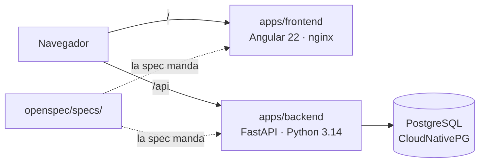
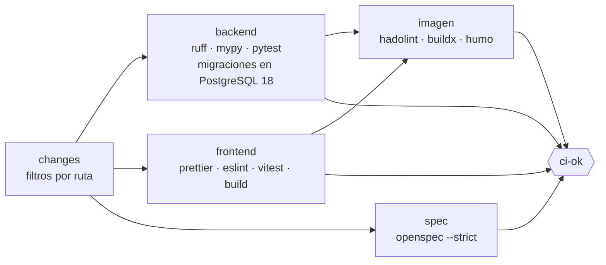

# <<=cookiecutter.service_slug=>>

> <<=cookiecutter.service_description=>>
>
> Generado con el *golden path* del [agentic-platform-lab](https://github.com/elpalmeral-org/agentic-platform-lab)
> (ADR 0035): nace como un esqueleto que arranca y pasa sus comprobaciones de plataforma, sin
> ninguna entidad de negocio todavía — el primer cambio real de este repo debería ser la primera
> *feature* real, por AIDLC (`/feature` o el motor abierto vía Port).



## Estructura

```
├── apps/
│   ├── backend/      FastAPI · SQLAlchemy 2.1 · Alembic · uv · ruff · mypy (strict) · pytest
│   └── frontend/     Angular 22 (standalone, zoneless, signals) · ESLint · Prettier · Vitest
└── openspec/         Spec-Driven Development: specs vigentes y cambios en curso
```

| | |
|---|---|
| Spec vigente | `openspec/specs/` — vacío al nacer; la primera *feature* real crea la primera spec |
| API | `GET /api/info` · docs en `/api/docs` — sin rutas de negocio todavía |
| Operación | `/healthz` · `/readyz` · `/metrics` (Prometheus) |

## Desarrollo local

Requisitos: [uv](https://docs.astral.sh/uv/) y Node ≥ 24.15.

```bash
# Backend (SQLite local; en el clúster es PostgreSQL)
cd apps/backend
uv sync
export <<=cookiecutter.env_prefix=>>DATABASE_URL="sqlite+pysqlite:///./dev.db"
uv run alembic upgrade head
uv run uvicorn <<=cookiecutter.package_name=>>.main:app --reload --port 8000

# Frontend (otra terminal): proxy de /api al backend en :8000
cd apps/frontend
npm ci
npm start            # http://localhost:4200
```

## Calidad

```bash
# Backend
cd apps/backend
uv run ruff format --check . && uv run ruff check . && uv run mypy && uv run pytest
uv run alembic check          # el modelo y las migraciones no divergen

# Frontend
cd apps/frontend
npm run format:check && npm run lint && npm run test:ci && npx ng build

# Spec
npx @fission-ai/openspec@1.15.0 validate --specs --strict
```

En cada PR, el workflow [`ci`](.github/workflows/ci.yml) ejecuta solo lo que ha cambiado
(backend, frontend, spec), construye la imagen de cada app modificada con una prueba de humo, y
publica un único check agregado, **`ci-ok`**. El check **`conventional-commits`** valida el título
del PR. Los dos son obligatorios para fusionar en `main`.



## Imágenes publicadas

Cada merge en `main` publica las dos imágenes en GHCR con SBOM y procedencia adjuntos, análisis de
Grype y **firma cosign keyless**. Cada release re-etiqueta el **mismo digest** como `X.Y.Z`.

| Imagen | Tags |
|---|---|
| `ghcr.io/elpalmeral-org/<<=cookiecutter.service_slug=>>-backend` | `sha-<commit>` · `X.Y.Z` |
| `ghcr.io/elpalmeral-org/<<=cookiecutter.service_slug=>>-frontend` | `sha-<commit>` · `X.Y.Z` |

Verificar que una imagen la firmó este repo (y no otro):

```bash
cosign verify ghcr.io/elpalmeral-org/<<=cookiecutter.service_slug=>>-backend:0.1.0 \
  --certificate-identity https://github.com/elpalmeral-org/<<=cookiecutter.service_slug=>>/.github/workflows/publish.yml@refs/heads/main \
  --certificate-oidc-issuer https://token.actions.githubusercontent.com
```

## Cómo cambia este repo

Trunk-based: rama corta → PR con título [Conventional Commits](https://www.conventionalcommits.org/es/)
→ *squash merge*. Cada merge en `main` despliega en **dev**; las versiones (`vX.Y.Z`) las crea
release-please y se promocionan a staging y prod por PR en
[`platform-gitops`](https://github.com/elpalmeral-org/platform-gitops).

## Entrega continua

Este repo **no despliega**: pide el despliegue abriendo un PR en `platform-gitops`, y la plataforma
lo acepta o lo rechaza con su check `gitops-ok`.

| Entorno | Qué llega | Cómo |
|---|---|---|
| dev | `sha-<commit>` | automático en cada merge en `main` (`publish.yml`), con auto-merge |
| staging | `X.Y.Z` | automático en cada release; el PR lo fusiona una persona |
| prod | `X.Y.Z` ya en staging | Actions → **promote** → `prod` → aprobar el entorno → fusionar el PR |

`promote` también admite `staging` para re-promocionar una release. Detalle y reglas:
[CI/CD del lab](https://github.com/elpalmeral-org/agentic-platform-lab/blob/main/docs/lab/ci-cd.md).
